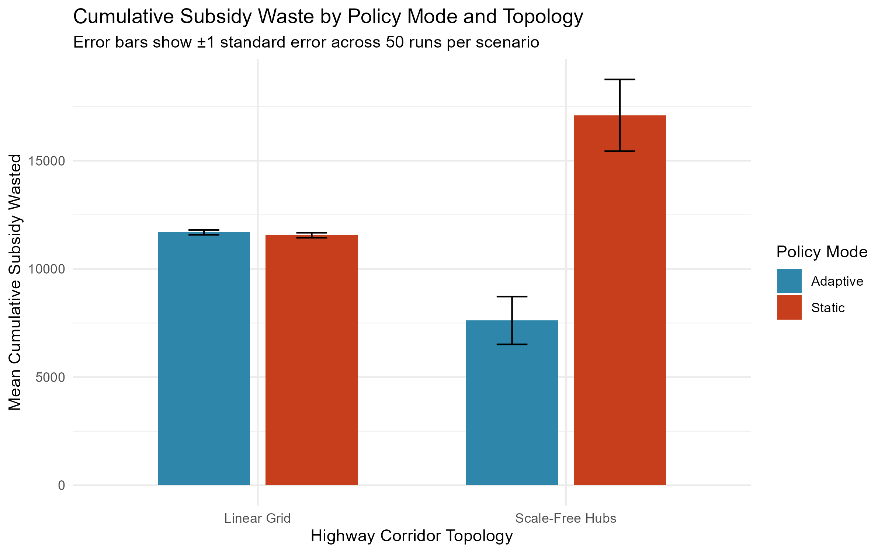

# Adaptive Governance in Tipping Markets
### An agent-based model of policy design and network topology in U.S. EV charging standardization

An agent-based model (NetLogo) and statistical analysis (R) of the competition between the CCS1 and NACS EV charging standards. It asks whether adaptive subsidy rules reduce stranded public assets compared with static ones, and how the physical layout of the charging network shapes the outcome. The work draws on Arthur's (1989) theory of path dependence and increasing returns.

*Author: Sarala Gautam, MSc Economics (EPOG). Course project, Complexity Economics, July 2026.*

## Design
- **2×2 experiment:** Static vs. Adaptive subsidy policy × Scale-Free Hub vs. Linear Grid network topology, 50 runs per cell (200 runs), 1,040 weekly steps.
- **Data:** a 1,200-station random sample of U.S. fast chargers from the DOE Alternative Fuels Data Center (https://afdc.energy.gov/), with 1,500 consumer agents. Policy milestones are calibrated to the 2021 Infrastructure Law and the 2023 recognition of NACS as SAE J3400.
- **Mechanisms:** consumers charge within a limited search radius, stations convert standards after two unprofitable years, and local influence is weighted by port capacity and reliability.

## Main findings
- Adaptive policy lowered cumulative subsidy waste in Scale-Free Hubs (mean 7,618 vs. 17,103) but made no detectable difference in the Linear Grid, where the policy trigger was never reached.
- Scale-Free Hubs produced a much wider spread of final NACS market share than the Linear Grid (maximum 68.5% vs. 20.3%), though no lower median. This is consistent with non-ergodic, path-dependent dynamics.
- A sensitivity analysis varied the adaptive threshold and the CCS1 reliability weight.

Full write-up: [`paper/abm-ev-charging-standards.pdf`](paper/abm-ev-charging-standards.pdf)

## Repository structure
- `netlogo/` model file (`.nlogox`) and its input CSVs
- `data/` BehaviorSpace outputs (main experiment and the two sensitivity experiments)
- `r/` analysis and plotting scripts
- `outputs/` figures and result tables
- `paper/` the paper (PDF)

## How to reproduce
1. Open `netlogo/CCS_NACS_netlogo.nlogox` in NetLogo [version]. Run the BehaviorSpace experiments `Thesisrun2`, `Sensitivity_Threshold` and `Sensitivity_Reliability`. The model reads its CSVs from the same folder.
2. In RStudio, run `r/R_Plotting.R` for the main analysis and figures, then `r/R_Sensitivity_Analysis.R` for the sensitivity tables. R packages: tidyverse, data.table, dplyr, rstudioapi.

## Limitations and next steps
This is a student project, and the following are known and under review:
- The reliability weights (1.00 NACS, 0.75 CCS1) and the 25% adaptive threshold were calibrated by iterative testing, not derived from data.
- The subsidy level (0.10) may not change station profit decisions in the current model, so policy modes may differ mainly in how waste is counted. A planned null-model check (Static vs. Adaptive, comparing market outcomes) will test this.
- The "waste" metric combines per-year subsidies and one-off retrofit costs. Reporting them separately is planned.
- The CCS1 reliability sensitivity run needs the hard-coded weight in `setup` removed before it can be rerun.
- "Scale-Free Hubs" and "Linear Grid" are algorithmic labels. Link length differs between them, which may confound the topology effect.
- The AFDC timeline file is loaded but the policy milestone is hard-coded at tick 104.

## Citation and license
Gautam, S. (2026). *Adaptive Governance in Tipping Markets.* Complexity Economics, [university]. See `LICENSE.txt`. Data source: U.S. DOE Alternative Fuels Data Center.
